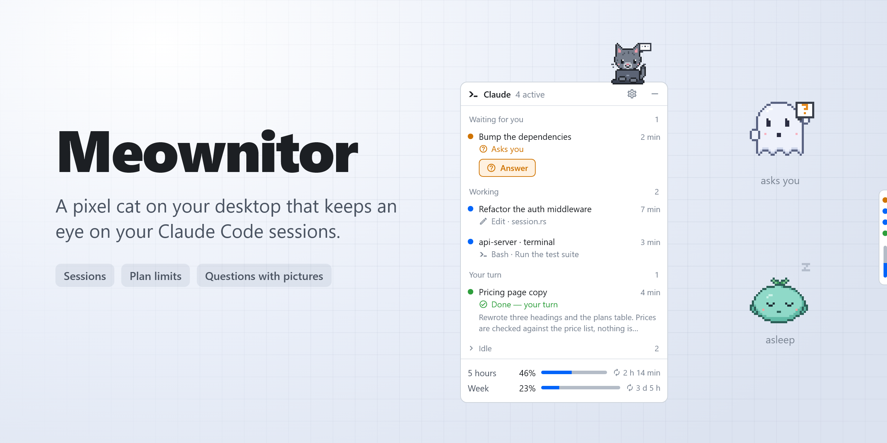
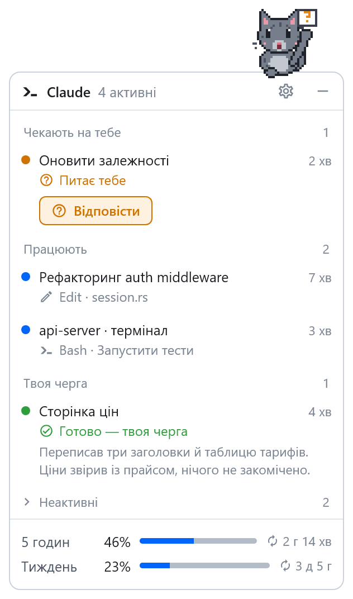
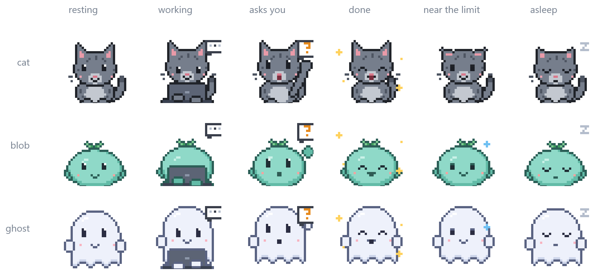

<picture>
  <source media="(prefers-color-scheme: dark)" srcset="docs/screenshots/hero-dark.png">
  
</picture>

**[Завантажити](https://github.com/kartatyi/meownitor/releases/latest)** ·
[Що вміє](#що-вміє) ·
[Встановлення](#встановлення) ·
[Як це працює](#як-це-працює) ·
[English](README.md)

**Meownitor** сидить у кутку екрана й одним поглядом показує, яка з ваших сесій Claude Code чекає на
вас, яка ще працює і над чим, і скільки лишилось від ліміту плану. А ще дає Claude ставити вам
питання з картинками замість стіни тексту.

> [!NOTE]
> Meownitor — неофіційний проєкт спільноти. Anthropic його не робить, не схвалює й не підтримує.

## Що вміє

<table>
<tr>
<td width="54%" valign="top">

### Сесії одним поглядом

Кожна сесія Claude Code за останню добу, з термінала чи з Claude Desktop, згрупована за тим, чого вона
від вас хоче:

- **Чекають на тебе**: питання, запит дозволу, раунд питань;
- **Працюють**, і над чим: команда, файл, який редагує, пошук;
- **Твоя черга**: хід закінчено, м'яч на вашому боці;
- **Неактивні**, згорнуті.

Сесія, що просить дозволу, показує, що саме просить дозволити, повністю; та, чий хід закінчено, —
початок того, що сказав Claude. Клац по сесії з Desktop відкриває її там; клац по сесії з термінала
дає скопіювати її команду `claude --resume` і відкрити її теку. Настрій улюбленця йде за сесіями.

### Дає про себе знати

Один звук, коли сесія починає чекати на вас, інший — коли хід закінчено, третій — коли вона
зупинилась із помилкою. Кожен обираєте з дюжини: три «мяу», два «кря», «ква», «ко-ко» й «бульк» —
це [записи](app/src/sounds/README.md), а ку-ку, піу, монетка й цвірінь, яким віджет озивався
завжди, робляться на льоту. Є повзунок гучності й вимикач для кожного. Якщо попросите, звук лунатиме знову що п'ять хвилин, поки сесія
чекає, і з ним прийде системне сповіщення.
**Не турбувати годину** в меню трею вимикає все це.

### Дозволи на картці

Вимкнено, доки не ввімкнете в налаштуваннях. Тоді запит дозволу спершу приходить на картку: на
рядку сесії з'являються **Дозволити**, **Відмовити** й **У терміналі**. Хук чекає на ваш клік до
двох хвилин, а далі лишає запит звичайному діалогу Claude Code.

### Ліміти плану

5-годинний і тижневий ліміт з часом скидання, ті самі числа, що показує `/usage`. Понад 85% улюбленець
виглядає втомленим.

### Питання з картинками

Із доданим скілом [`meownitor-round`](skill/meownitor-round/SKILL.md) сесія малює свої варіанти на одній
сторінці й чекає: макети, дизайни, схеми, рендер зі змінами в рамках і під номерами. Віджет
цвірінькає, ви обираєте й коментуєте у вікні, і відповідь іде просто в сесію.

</td>
<td width="46%" align="center" valign="top">

<picture>
  <source media="(prefers-color-scheme: dark)" srcset="docs/screenshots/card-uk-dark.png">
  
</picture>

</td>
</tr>
</table>

### Улюбленець із настроями

<picture>
  <source media="(prefers-color-scheme: dark)" srcset="docs/screenshots/moods-dark.png">
  
</picture>

Котик, краплинка або привидок. Стежить очима за курсором, любить, коли його гладять (поводіть
курсором туди-сюди над ним), засинає, коли довго нічого не відбувається, і пропускає кліки крізь
прозорі пікселі. Тягніть його куди завгодно. Киньте біля лівого чи правого краю екрана — і він стане
тонкою смужкою, з якої на наведення виїжджає картка.

### Налаштування на звороті картки

Шестерня перевертає картку: персонаж, мова (English або українська), про що й як сповіщати,
ховатись під повноекранним вікном (Windows), дозволи на картці, запуск під час входу і хук Claude
Code, який ставиться чи знімається одним кліком.

## Встановлення

**Потрібно:** [Claude Code](https://code.claude.com/docs/en/overview) і одне з:

- **Windows** 10 або 11 (WebView2 уже вбудований);
- **macOS** 11 або новіша, Apple silicon чи Intel. *Експериментально:* зібраний з коду віджет уже
  працював на Mac (macOS 26.3, Apple silicon), а образ диска з релізу поки що лише збирають і
  запускають у CI, тож [повідомлення](https://github.com/kartatyi/meownitor/issues) вітаються;
- **Linux** x86-64 із композитним робочим столом (для прозорого вікна) і треєм; у GNOME для цього
  потрібне [розширення AppIndicator](https://extensions.gnome.org/extension/615/appindicator-support/).
  У Wayland віджет працює через XWayland, бо Wayland не дозволяє вікну самому обирати своє місце.

Claude Desktop — за бажанням: з ним видно назви сесій і працює відкриття в Desktop. Claude Desktop для
Linux немає, тож там віджет показує сесії, які ви запускаєте в терміналі.

1. Візьміть пакет для вашої системи з **[останнього релізу](https://github.com/kartatyi/meownitor/releases/latest)**:

   | Система | Файл | Далі |
   |---|---|---|
   | Windows | `Meownitor_<версія>_x64-setup.exe` | запустіть; ставиться лише для вашого користувача, права адміністратора не потрібні |
   | macOS | `Meownitor_<версія>_universal.dmg` | відкрийте і перетягніть Meownitor у Програми |
   | Debian, Ubuntu | `Meownitor_<версія>_amd64.deb` | `sudo apt install ./Meownitor_<версія>_amd64.deb` |
   | Fedora, openSUSE | `Meownitor_<версія>_x86_64.rpm` | `sudo dnf install ./Meownitor_<версія>_x86_64.rpm` |
   | Будь-який Linux | `Meownitor_<версія>_amd64.AppImage` | `chmod +x` і запустіть |

   > [!TIP]
   > Жоден пакет не підписано платним сертифікатом. У Windows SmartScreen може сказати, що не знає цієї
   > програми: **Докладніше → Виконати однаково**. У macOS перший запуск відхиляється: відкрийте
   > **Системні параметри → Приватність і безпека** і натисніть **Все одно відкрити** біля Meownitor, або
   > виконайте `xattr -dr com.apple.quarantine /Applications/Meownitor.app`. До кожного релізу додано
   > SHA-256 файлів у `SHA256SUMS.txt`.

2. Улюбленець з'явиться в правому нижньому куті з відкритою карткою, а на картці буде сказано, що
   хук Claude Code не стоїть.
3. Перемкніть мову на **Українська**, якщо треба: шестерня ⚙.
4. **Поставити** на картці, тоді **Додати** (згодом це шестерня ⚙ → **Хук Claude Code**). Це додає хук
   віджета в `~/.claude/settings.json`. Інші ваші хуки
   лишаються як є, а копія файлу лягає поруч. Сесія з'явиться з наступної ж своєї дії. Разом із ним у
   `~/.claude/skills/` ставиться скіл `meownitor-round` для питань із картинками, і кожне оновлення
   віджета приносить свій.
5. Для лімітів увійдіть у Claude Code один раз: `claude`, потім `/login`. У macOS віджет читає цей вхід
   із Keychain, і macOS може раз спитати, чи дати `security` прочитати «Claude Code-credentials»:
   **Always Allow**.

**Портативна версія для Windows:** розпакуйте `Meownitor_<версія>_x64-portable.zip` куди завгодно,
запустіть `meownitor.exe` і пройдіть кроки 2–5.

### Як користуватись

| | |
|---|---|
| Клац по улюбленцю | відкрити картку |
| `–` у заголовку картки | назад до самого улюбленця |
| Тягнути улюбленця, заголовок картки чи смужку | перемістити; прилипає до краю екрана |
| Кинути біля лівого чи правого краю | смужка біля краю; на наведення виїжджає картка |
| Клац по сесії | відкрити в Claude Desktop; сесія з термінала розгортає **claude --resume** (копіює команду) і **Відкрити теку** |
| **Відповісти** на сесії | відкрити її раунд питань |
| **Дозволити** / **Відмовити** / **У терміналі** на сесії | відповісти на її запит дозволу або лишити його діалогу Claude Code (якщо ввімкнено в налаштуваннях) |
| ⚙ | налаштування |
| Іконка в треї (рядок меню в macOS) | відкрити картку чи налаштування, сховати віджет на годину, не турбувати годину, тека з даними й логами, настрої й персонажі, вийти. У Windows клац по іконці відкриває картку, а наведення каже, хто чекає і хто працює |

### Видалення

**Windows:** Параметри → Програми → **Meownitor** → Видалити. Це знімає хук з
`~/.claude/settings.json` і вимикає запуск із Windows. Позначте **Delete the application data**, щоб
прибрати й `~/.meownitor`. Якщо встановите знову, хук і автозапуск повернуться самі.

**macOS і Linux:** видалення програми не дістає до ваших налаштувань, тож спершу відкрийте ⚙, натисніть
**Хук Claude Code → Зняти** і вимкніть автозапуск. Потім вийдіть через трей і видаліть програму:
перетягніть її з Програм у Кошик, виконайте `sudo apt remove meownitor` чи `sudo dnf remove meownitor`
або видаліть AppImage. У `~/.meownitor` лежать дані віджета; за бажанням видаліть і її.

## Як це працює

- **Сесії.** `meownitor-hook` — [хук Claude Code](https://code.claude.com/docs/en/hooks) на 12
  подій. На кожну подію він записує, що робить сесія, у `~/.meownitor/sessions/<id>.json`
  і виходить за мілісекунди. Він ніколи не гальмує Claude і не валить його. Віджет зводить ці файли із
  записами Claude Desktop (назви, архівна чи ні, посилання `claude://`) і з транскриптом сесії — так він
  бачить хід, який ви зупинили. Тека на кожній системі — `~/.meownitor`. У Windows це не AppData, бо
  Claude Desktop там — пакет MSIX: усе, що він запускає, бачить AppData через власну копію пакета, тож
  сесія в Desktop і сесія в терміналі писали б у різні місця.
- **Дозволи на картці.** Коли це ввімкнено, хук, який Claude Code запускає перед тим, як спитати
  дозволу, з'єднується з віджетом і чекає на ваш клік до двох хвилин. Порт відкрито лише на
  `127.0.0.1`, а відповідь може прийти тільки з власного вікна віджета: сесія не може виписати її
  собі сама. Без кліку, без віджета чи на **У терміналі** хук мовчить, і Claude Code питає, як
  завжди. `widget.log` зберігає, що було відповіджено.
- **Ліміти.** Раз на хвилину віджет робить той самий запит, що й `/usage` у Claude Code. Це запит про
  акаунт, а не виклик моделі, тож лімітів він не витрачає. Бере вхід Claude Code з
  `~/.claude/.credentials.json` і оновлює токен так, як це робить Claude Code. У macOS Claude Code
  натомість тримає вхід у Keychain, і там віджет його лише читає: коли цей токен спливає, картка
  лишає останні числа (а якщо їх ще не було, пише, що чекає на Claude Code), доки той наступного
  разу не запуститься й не оновить вхід. Коли сервер зайнятий,
  останні числа лишаються на картці, а запити йдуть рідше.
- **Питання.** Сесія пише одну HTML-сторінку у свою теку раундів (`meownitor-hook where`) і у фоні
  запускає `meownitor-hook ask <name>`, що перевіряє сторінку й чекає. Віджет показує сторінку з
  вбудованим у нього набором для сторінок у власному вікні. Коли ви
  натискаєте **Надіслати**, відповідь лягає поруч зі сторінкою, а команда, що чекала, передає її сесії.
  Вона чекає до доби; відповідь, надіслана пізніше, дійде до сесії з вашим наступним повідомленням.
  Питання лишається у віджеті, доки на нього нема відповіді, хоч і кілька днів.
  Якщо ви відповіли в чаті, сесія забирає питання (`meownitor-hook drop <name>`), і віджет
  перестає питати.
  Повний контракт — у [`SKILL.md`](skill/meownitor-round/SKILL.md) скіла.

### Приватність

- Усе лишається на вашому комп'ютері. Мережа — лише до Anthropic: запит про використання і оновлення
  токена, коли вхід Claude Code ось-ось спливе (записується назад у `~/.claude/.credentials.json`, як це
  робить Claude Code; у macOS ніколи, там Keychain лише читається). Токени ніде не логуються.
- Жодної телеметрії й аналітики.
- Хук записує стан кожної сесії, назву поточного інструмента й одну коротку деталь: назву файлу, опис
  команди, шаблон пошуку. Поки сесія чекає дозволу, він тримає ще й те, що просять, повністю
  (команду, шлях), а коли хід закінчено — початок останньої відповіді Claude; і те, і те лише щоб
  показати на картці. `events.log` тримає останні 512 КБ назв подій.
- Віджет прибирає за собою: файл стану сесії зникає за тиждень після її останньої події, раунди
  сесії (сторінки, картинки, відповіді) — за місяць після останньої зміни в них. Раунд, що досі
  чекає на вашу відповідь, не видаляється ніколи.
- `~/.claude/settings.json` змінюється лише коли ви тиснете «Поставити» чи «Зняти», видаляєте
  програму або оновлення переносить копію хука чи ставить його інакше, ніж раніше (подія, якої хук
  не слухав, довше чекання на запит дозволу), і щоразу спершу робиться його копія.

## Збірка з коду, релізи

Див. [англійський README](README.md#build-from-source).

## Участь

Повідомлення про помилки, ідеї й pull request-и — див. [CONTRIBUTING.md](CONTRIBUTING.md) (англійською). Вразливості — [SECURITY.md](SECURITY.md).

## Ліцензія

[MIT](LICENSE) © 2026 Vladyslav Yurchenko
